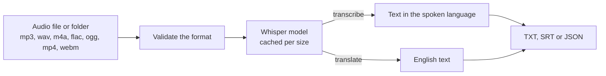

# Offline Audio Transcription and Translation

A command-line tool that transcribes speech in dozens of languages, or translates it into English, using OpenAI's open-source Whisper model on your own machine. No API key, no per-minute cost, and no audio leaves the computer.

## Highlights

- **Runs locally.** Whisper's weights download once and are cached; after that, everything works offline.
- **Two tasks, one model.** `transcribe` writes text in the spoken language, which Whisper detects automatically. `translate` writes English text from any supported language, using Whisper's built-in translation mode.
- **Three output formats.** Plain text, SRT subtitles, or JSON with per-segment timestamps and the detected language.
- **Single files or whole folders.** Batch mode processes every supported file in a directory, and loads each model size only once.
- **Fails fast.** Missing files and unsupported formats are rejected before the model loads.

## How it works



## Model sizes

| Size | Trade-off |
|---|---|
| `tiny`, `base` | Fastest; `base` is the default |
| `small`, `medium` | More accurate, slower |
| `large` | Most accurate; needs the most memory |

## Project structure

```
src/
  audio_input.py     Finds and validates audio files before the model loads
  transcriber.py     Loads and caches Whisper models; runs transcribe or translate
  output_writer.py   Formats Whisper's output as TXT, SRT or JSON
main.py              Command-line entry point
tests/               Unit tests for input validation and the output formats
```

## Getting started

```bash
python -m venv venv
source venv/bin/activate          # Windows: venv\Scripts\activate
pip install -r requirements.txt
```

Whisper decodes audio with **ffmpeg**, so install it and make sure it's on your `PATH`: `brew install ffmpeg`, `apt-get install ffmpeg`, or the [Windows builds](https://www.gyan.dev/ffmpeg/builds/).

## Usage

```bash
# Transcribe in the spoken language, as SRT subtitles
python main.py --input interview.mp3 --task transcribe --format srt

# Translate to English, as plain text
python main.py --input interview.mp3 --task translate --format txt

# Process every supported file in a folder, as JSON
python main.py --input-dir recordings --task transcribe --format json

# A larger, more accurate model
python main.py --input interview.mp3 --model-size medium
```

Output files are written to `--output-dir` (default `outputs/`), named after each input file.

## Tests

```bash
pytest
```

12 unit tests cover input validation (supported formats, sorting, missing and unsupported files) and the three output formats, including SRT timestamp formatting. They need neither Whisper nor ffmpeg.

## Design notes

- **The open-source package, not the paid API.** `openai-whisper` runs the model locally, which keeps recordings private and costs nothing per minute.
- **Whisper's own translation.** The `translate` task uses Whisper's built-in mode rather than a second translation model. It translates into English only, which is how Whisper works.
- **Validation before inference.** Checking the file first gives a clear error in milliseconds, instead of a failure deep inside ffmpeg after the model has loaded.

## Roadmap

- Word-level timestamps
- Speaker diarization, to label who said what
- An optional faster-whisper backend for quicker CPU and GPU runs
